# CNA 3D Museum

A first-person 3D museum that teaches the [CNA](../cna) framework (a C++ port of the XNA 4.0 API with extras) by
letting you walk through it. Ten floors of exhibit rooms; every room demonstrates one thing, labels the API it is
using, says whether that API is **XNA 4.0** or a **CNA extension**, and has something to click, drag or toggle.

The museum is an ordinary CNA application: it uses CNA's public API directly and adds no engine of its own. The only
code above CNA is application structure (rooms, portals, a floor map, an exhibit framework).

| | | |
|---|---|---|
| 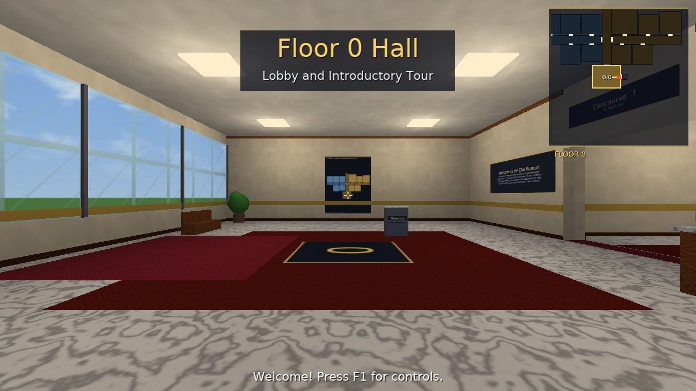 | 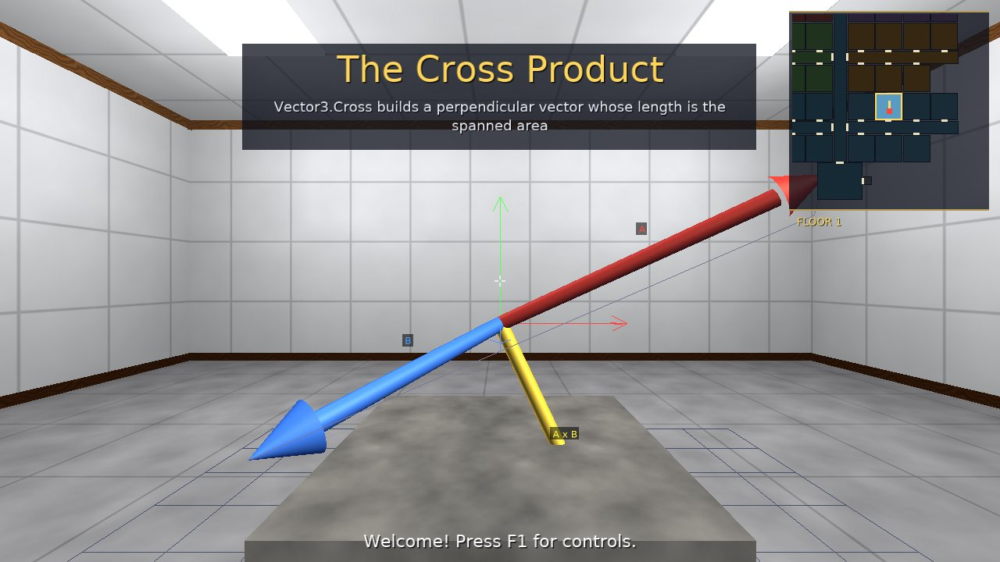 | 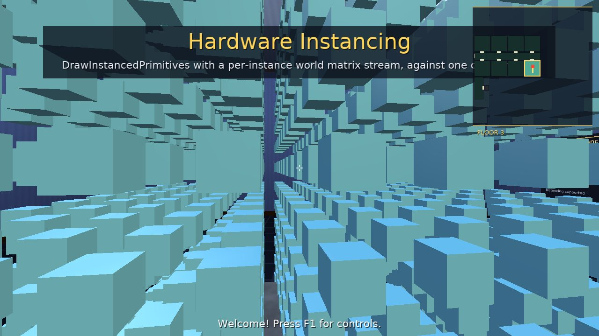 |
| The entrance hall | Floor 1: the cross product | Floor 3: instanced drawing |
| 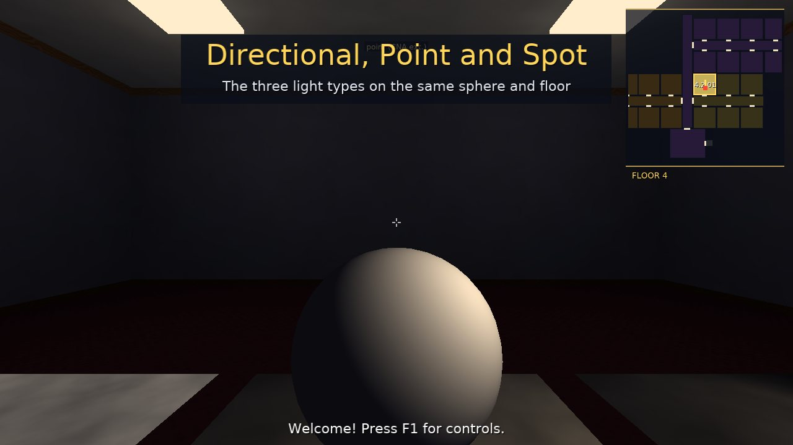 | 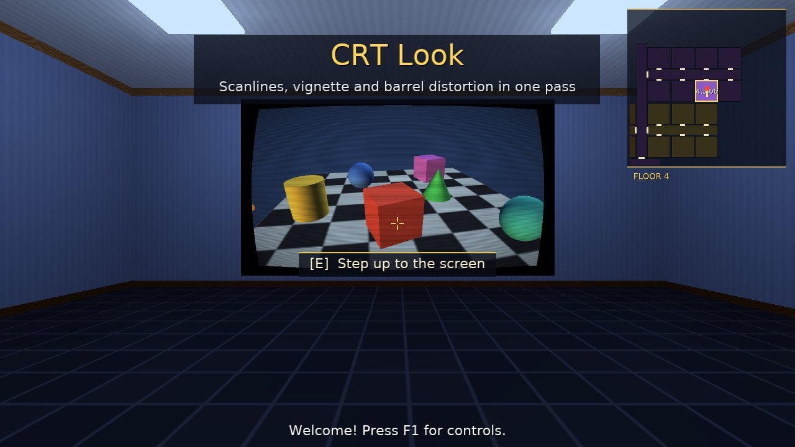 | 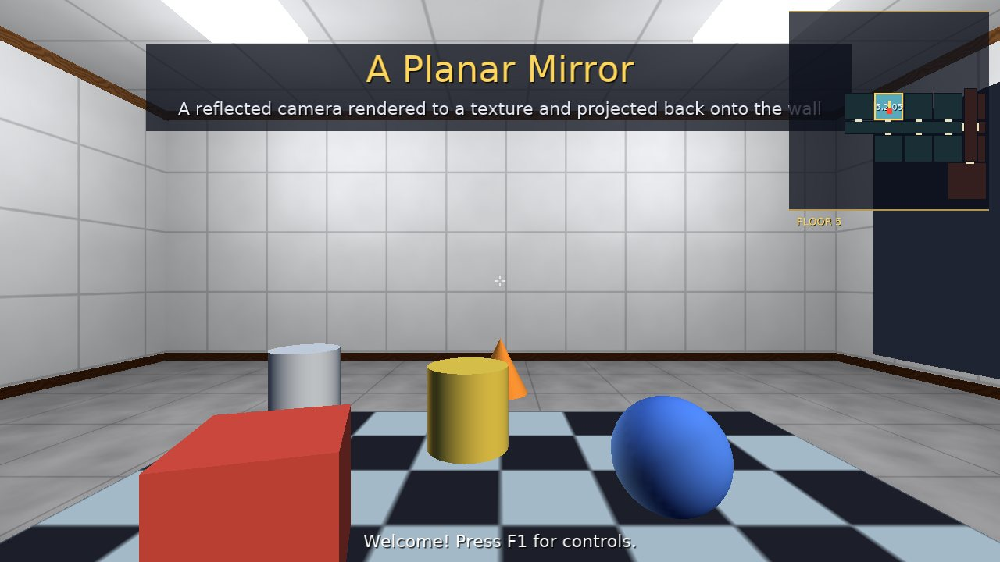 |
| Floor 4: light types | Floor 4: a CRT shader | Floor 5: a planar mirror from a render target |
| 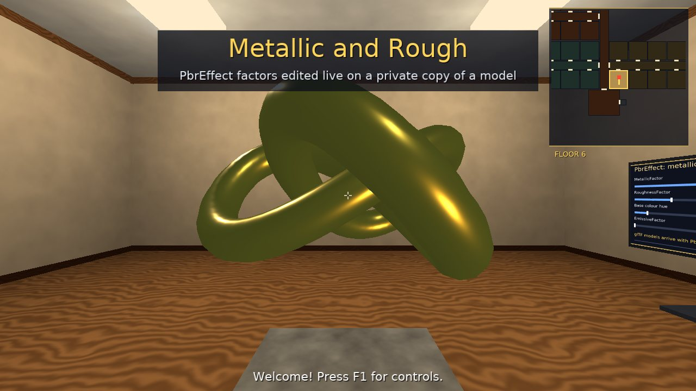 | 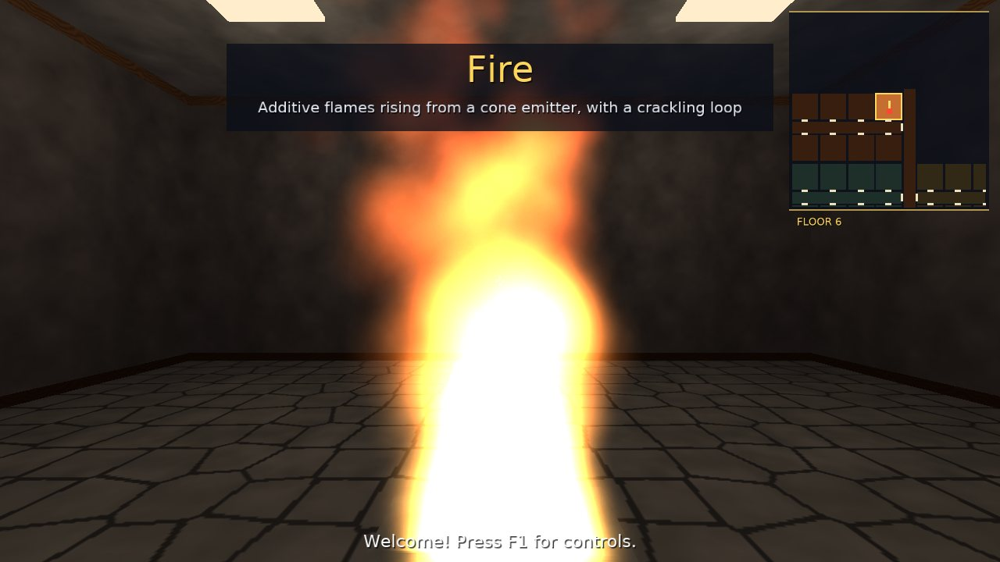 | 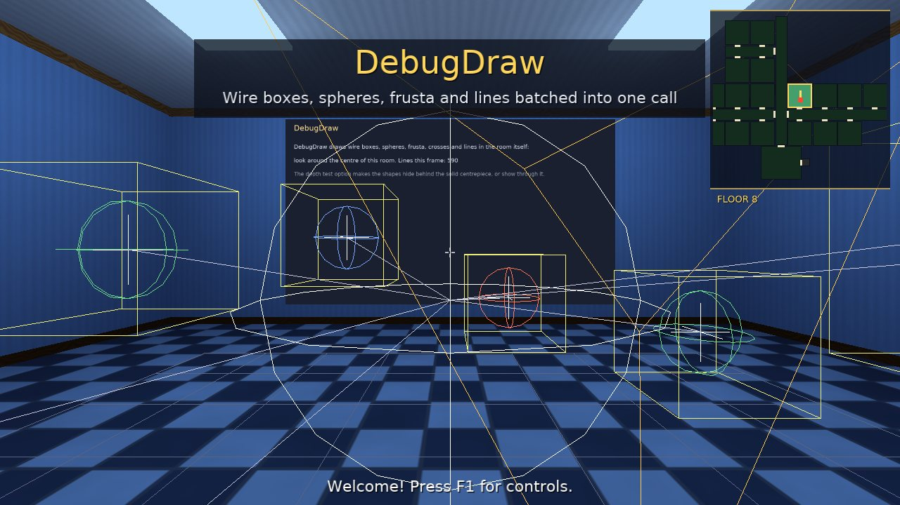 |
| Floor 6: a glTF model with PbrEffect | Floor 6: a particle fire | Floor 8: CNA's DebugDraw |
| 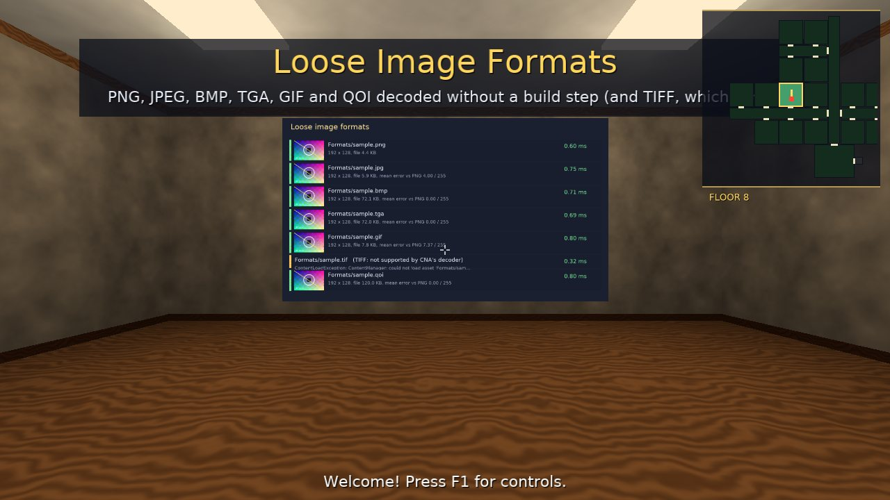 | 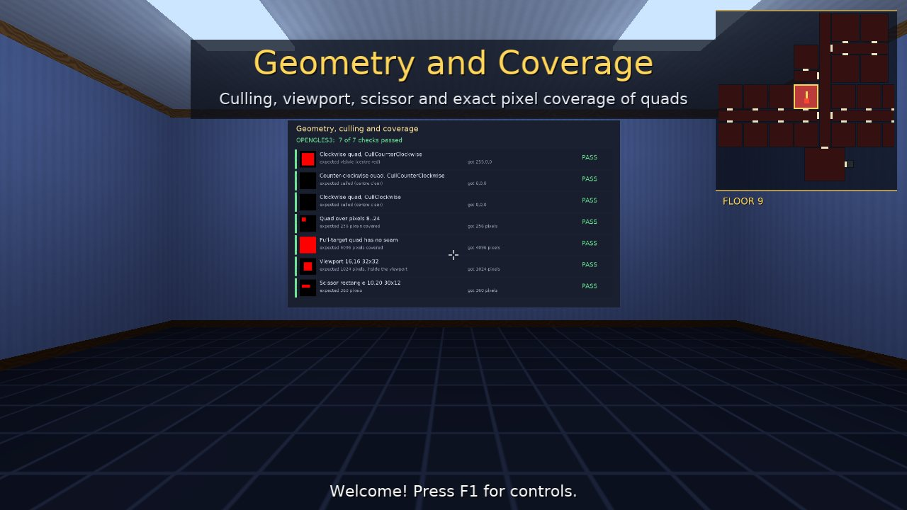 | 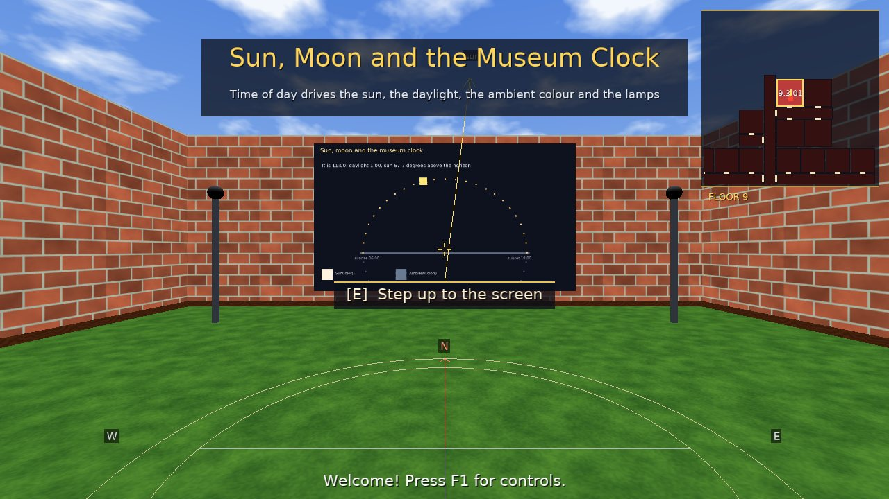 |
| Floor 8: image formats decoded by ContentManager | Floor 9: renderer self-checks | Floor 9: the observation deck |

All images are real frames from the running museum (`tools/readme_shots.sh`), not mock-ups.

## What is in it

<!-- BEGIN COUNTS -->
```
floors:          10
wings:           35
exhibit rooms:   269  (5 outdoors)
walkable cells:  334  (rooms, galleries, concourses, halls, elevators)
exhibit kinds:   52
origin:          215 XNA 4.0, 54 CNA extension, 0 application
API names:       644
  floor 0  10 rooms  Lobby and Introductory Tour
  floor 1  53 rooms  Fundamentals
  floor 2  23 rooms  Two-Dimensional Rendering
  floor 3  20 rooms  Three-Dimensional Fundamentals
  floor 4  28 rooms  Effects and Lighting
  floor 5  24 rooms  Render State and Render Targets
  floor 6  36 rooms  Models, Animation and Particles
  floor 7  18 rooms  Audio and Input
  floor 8  34 rooms  Content, Platform and CNA
  floor 9  23 rooms  Performance and Validation
```
<!-- END COUNTS -->

The numbers above are generated from the museum's own catalogue (`tools/gen_docs.sh`). The floors:

| Floor | Subject |
|---|---|
| 0 | Entrance lobby and a first tour: models, materials, lighting, sky, render state, targets, particles, animation, audio |
| 1 | Fundamentals: application model, vectors, matrices, rotations, curves, collision geometry, cameras |
| 2 | Two-dimensional rendering: SpriteBatch in depth, SpriteFont and text |
| 3 | Three-dimensional fundamentals: buffers, primitives, dynamic geometry, instancing, textures |
| 4 | Effects and lighting: BasicEffect super-wing, a lighting lab, CNA ShaderEffect shaders |
| 5 | Render state gallery and render-target complex (mirrors, MRT, float targets) |
| 6 | Models (glTF, PBR, SkinnedEffect), animation, particles, simulations (flocking, collisions, integrators, inverse kinematics) |
| 7 | Audio (3D audio, synthesis, music, microphone) and input (keyboard, mouse, game pad, text, joystick) |
| 8 | Content pipeline, CNA extensions (DebugDraw, CRT, depth and ASCII effects, shader packages, shadow mapping, statistics, devices), platform queries, players and networking (GamerServices, the Guide, achievements, packets, sessions), a history of XNA and of this build of CNA |
| 9 | Performance lab, renderer validation, reference scenes, the observation deck |

Maps and indexes: [docs/MUSEUM_MAP.md](docs/MUSEUM_MAP.md) (every room), [docs/CNA_COVERAGE.md](docs/CNA_COVERAGE.md)
(what CNA covers and what does not), [docs/REFERENCE_VIEWS.md](docs/REFERENCE_VIEWS.md).

## Build

Requirements: a C++23 compiler, CMake 3.20+, Ninja (optional), CNA and its sibling checkouts next to this one
(`../cna`, `../sharp-runtime`, `../meta-gl`, ...), SDL3 development files as CNA requires. ccache is used when it is
installed and is optional. On Linux the museum has been built and run with GCC 14.

```bash
tools/build.sh                         # configure on first use, then build; prints only errors and the museum's own warnings
build/bin/cna-3d-museum                # run it
```

`tools/build.sh [TARGET...]` always builds in `build/` (set `BUILD_DIR` to use another tree). Useful variants:

```bash
# A build that can run on several renderers; the first is the default, CNA_GRAPHICS_RENDERER picks one at run time.
MUSEUM_RENDERERS="OPENGLES3;OPENGL33;SOFTWARE" tools/build.sh
CNA_GRAPHICS_RENDERER=SOFTWARE build/bin/cna-3d-museum

RECONFIGURE=1 tools/build.sh           # force a CMake configure
VERBOSE=1 tools/build.sh               # stream the whole build log
MUSEUM_CMAKE_ARGS="-DCNA_CNAEXT=OFF" RECONFIGURE=1 tools/build.sh    # build without CNA's extension module
```

The museum switches on three CNA options in its `CMakeLists.txt`: `CNA_CNAEXT` (DebugDraw and the post-process
effects), `CNA_DEVICES` (device queries) and `CNA_DIAGNOSTICS=STATS` (engine counters). Each exhibit that needs one
checks for it and says so in the room when it is missing (a build with all three off was tried: it compiles, every room runs, and those rooms show a notice).

The build also compiles `Content/Pipeline/` with CNA's own content compiler (`cna-content`) into `.cnb` and `.xnb`
files next to the executable; that is what the *Content Compiler* room loads.

## Controls

| Key | Action |
|---|---|
| `W A S D` / `Up Down` | walk (Shift: faster) |
| mouse, or `Left Right` and `Page Up/Down` | look around |
| `E` or left click | interact with what the crosshair is on (buttons, sliders, doors) |
| `Q` or right click | previous choice on a panel |
| `M` / `Tab` | the directory and map: floor tabs, search, quick travel |
| `N` | minimap on/off |
| `T`, `Shift+T`, `Y` | museum clock: hour later/earlier, let the day run |
| `F1` / `H` | controls overlay |
| `F3` | statistics overlay |
| `F2` | mute audio |
| `[` `]` | mouse sensitivity |
| `R` | back to the entrance |
| `Esc` | pause menu (the mouse is released) |
| `F11` | full screen |

Game pad (optional): left stick walk, right stick look, A interact, Start pause. No exhibit requires a pad, a
joystick, a touch screen or a microphone. In *The Game Pad* room CNA's keyboard-emulated pad lets you try one without
hardware.

### Finding your way

- Every floor has a hall, a concourse and wings. Room numbers (`4.2.07`) are on each room's door plaque.
- The **elevator** is east of every hall: ten buttons, one per floor.
- The **directory** (`M`) lists every room by floor and wing with a map, supports search, and quick-travels
  (Enter, or click twice) to rooms on floors you have visited.
- The **minimap** (top right) follows you; the floor numeral on the hall rug and the floor accent colour tell you where you are.
- Room banners and the door-side plaque name the API, say what the controls do and what to expect.

## Command line

`build/bin/cna-3d-museum --help` lists all options. The ones used by the tools:

| Option | Purpose |
|---|---|
| `--room KEY`, `--pos X,Y,Z`, `--yaw`, `--pitch` | start somewhere specific (`--list-rooms` prints the keys) |
| `--view NAME`, `--no-hud`, `--time HOURS` | a named reference view, without overlay, at a fixed museum hour |
| `--screenshot FILE [--screenshot-frame N]` | save one frame and exit |
| `--script "a;b;c"` | scripted actions: `goto:`, `at:`, `walk:`, `press:LABEL=V`, `use:`, `time:`, `shot:`, `quit` ... |
| `--fixed-step S`, `--frames N` | deterministic, bounded runs |
| `--validate`, `--inventory`, `--list-rooms`, `--list-turned-rooms`, `--list-views`, `--map-markdown`, `--coverage-markdown` | data-only commands, no window |
| `--no-audio`, `--volume`, `--width`, `--height`, `--fullscreen` | usual switches |
| `--no-save`, `--fresh`, `--save` | the visited rooms are kept between runs in CNA's per-user storage (`StorageDevice`); scripted and screenshot runs never touch it unless `--save` |

## Testing

| Tool | What it checks |
|---|---|
| `build/bin/museum_tests` (also `ctest --test-dir build`; build it with `tools/build.sh cna-3d-museum museum_tests`) | catalogue validity, unique keys and numbers, door symmetry, graph connectivity of every floor, spawn and cell lookup, exhibit registry, missing assets |
| `cna-3d-museum --validate` | the same structure checks without a window; the museum also runs them at every start-up and logs any `INVALID:` problem |
| `tools/tour.sh [-f FRAMES] [-p] [ROOM...]` | visits **every** room (or those named), prints engine statistics, exit status 0 only if nothing threw; `-p` also operates every control of every room through its whole range |
| `tools/leak_check.sh` | tours every room once and three times: peak memory and registered textures must not grow |
| `tools/nav_test.sh` | rides the elevator to every floor, opens the directory, and checks the arrival floor |
| `tools/renderer_check.sh [RENDERER...]` | runs the floor 9 *Renderer Validation* self-checks on each renderer and prints a PASS/FAIL matrix |
| `tools/reference.sh capture\|compare` | visual regression: renders the named reference views and compares them with stored images |
| `tools/room_diff.sh RENDERER` | every room's arrival view on RENDERER against OPENGLES3, ranked by differing pixels (needs both in one build) |
| `tools/check_all.sh` | the whole battery on the default renderer (build, tests, validation, documentation freshness, tour with every control, navigation, renderer checks, visual regression, memory); `SLOW=1` adds OPENGL33 and SOFTWARE |
| `tools/run.sh "script"`, `tools/shot.sh OUT.png ...`, `tools/roomshots.sh OUT.png KEY...` | run a script, take a screenshot, or a contact sheet of rooms, on a private virtual display (Xvfb) |

None of the scripts touches your real display. Failures are never swallowed: a crash, a timeout or a missing
screenshot is a non-zero exit status.

## Renderers

The museum uses only portable CNA calls, so any 3D-capable renderer should work; it checks capabilities and says so
in the room when something is unavailable (for example wireframe fill on OPENGLES3). Tested here (the last three need CNA's optional dependencies; see [docs/RENDERER_TESTING.md](docs/RENDERER_TESTING.md)):

| Renderer | Whole museum tour | Self-checks (floor 9) | Notes |
|---|---|---|---|
| OPENGLES3 (default) | all rooms clean | all pass | the reference renderer; `tests/reference/OPENGLES3` |
| OPENGL33 | all rooms clean | all pass | screenshots identical to OPENGLES3 |
| SOFTWARE | all rooms clean (about 25 minutes under Xvfb) | all pass | CPU rasteriser; no window, so mouse look is off: use the keyboard |
| SOFTWARE, Windows build under Wine | all rooms clean (MinGW cross build) | - | `docs/RENDERER_TESTING.md` has the recipe; found a Windows-only bug (`localtime_r`) |
| FNA3D | all rooms clean | all but one pass, one skipped | no custom shaders, no PBR (models fall back to `BasicEffect`), `PunctualLightEXT` ignored, no instancing with stock effects |
| WEBGPU (llvmpipe) | all rooms clean | all pass | takes WGSL: the shader rooms run on WGSL sources the museum carries; the MRT edge map and the shadow-map caster do not |
| SDL_GPU (llvmpipe) | all rooms clean | all pass | takes SPIR-V: the shader rooms compile Vulkan GLSL at run time; the shadow-map caster does not |

Details, the per-renderer check matrix and what was found are in [docs/RENDERER_TESTING.md](docs/RENDERER_TESTING.md).

## Known limitations

See [docs/KNOWN_ISSUES.md](docs/KNOWN_ISSUES.md). In short: no stairs or escalators (elevators and the directory move
you between floors); real audio output was verified to start and
stream on a PipeWire machine but audibility cannot be judged by a test; Video, avatars and
networking between machines are not
demonstrated (see [docs/CNA_COVERAGE.md](docs/CNA_COVERAGE.md)).

## Repository layout

| Path | Contents |
|---|---|
| `src/Catalogue` | the museum as data: floors, wings, rooms, themes, reference views, inventory |
| `src/World` | layout, lazy building and activation of rooms, portals and visibility, collision |
| `src/Exhibits` | the exhibit framework and one directory per subject (`Math`, `Sprites`, `Geometry`, `Perf`, `Validation`, ...) |
| `src/Rendering`, `src/Interaction`, `src/UI`, `src/Audio`, `src/Camera`, `src/Diagnostics` | application helpers (gizmos, control panels, HUD, floor map, player controller) |
| `Content/` | procedural textures, glTF models, WAV sounds, an XACT project, fonts, content-pipeline samples (generated by `tools/gen_*.py`) |
| `tests/` | structure tests and the visual-regression reference images |
| `tools/` | build, run, test, documentation and asset-generation scripts |
| `docs/` | map, coverage, architecture, renderer testing, known issues, CNA API notes |
| `HANDOFF.md` | current state and next steps for whoever continues |

Architecture: [docs/ARCHITECTURE.md](docs/ARCHITECTURE.md).

## License

MIT, see [LICENSE](LICENSE). The bundled DejaVu font keeps its own license (`Content/Fonts/LICENSE-DejaVu.txt`).
